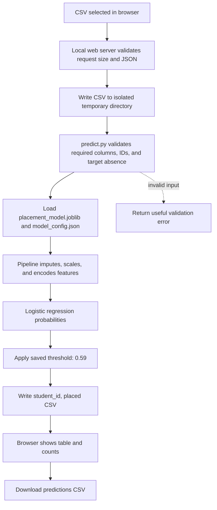
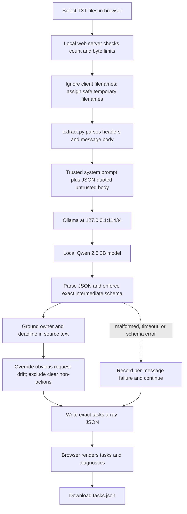
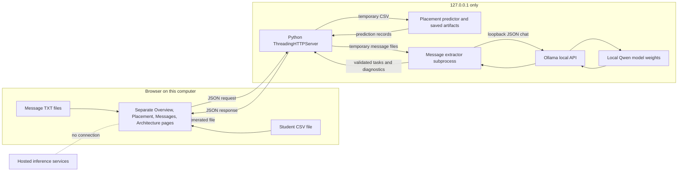

# Architecture and Mermaid flowcharts

Render the following blocks in any Mermaid-compatible Markdown preview.

## 1. Student placement prediction

The fitted preprocessing and classifier travel together in the saved pipeline. `student_id` is carried to output; `status_code` is validated as an input column but omitted from model features because its timing and meaning are undocumented.

## 2. Class message task extraction

Message contents are sent only to the loopback Ollama API. The prompt and validation controls reduce prompt-injection and unsupported-claim risks; they do not guarantee semantic correctness.

## 3. Local web application and trust boundaries

The development server binds only to loopback addresses. It does not accept filesystem paths or model names from the browser, ignores uploaded filenames for disk placement, imposes upload limits, and serves a restrictive Content Security Policy.
